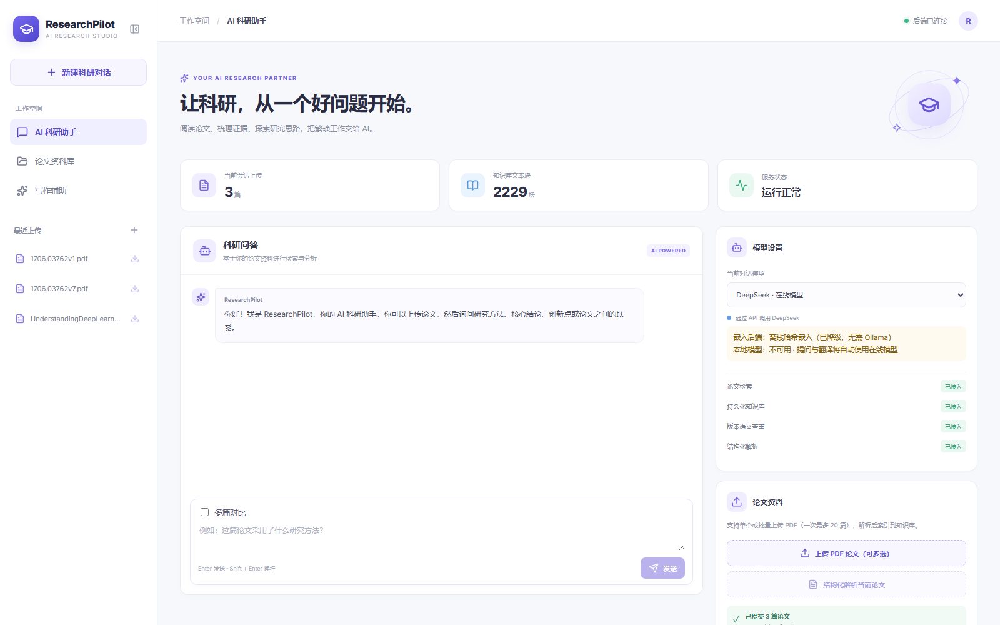
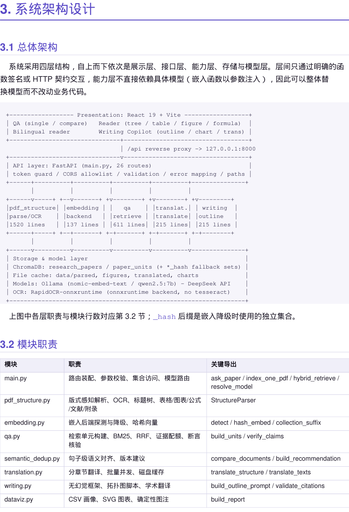
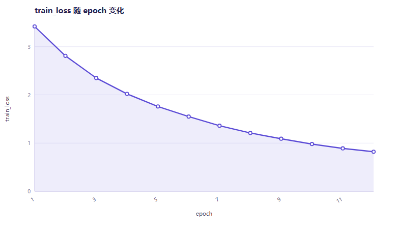
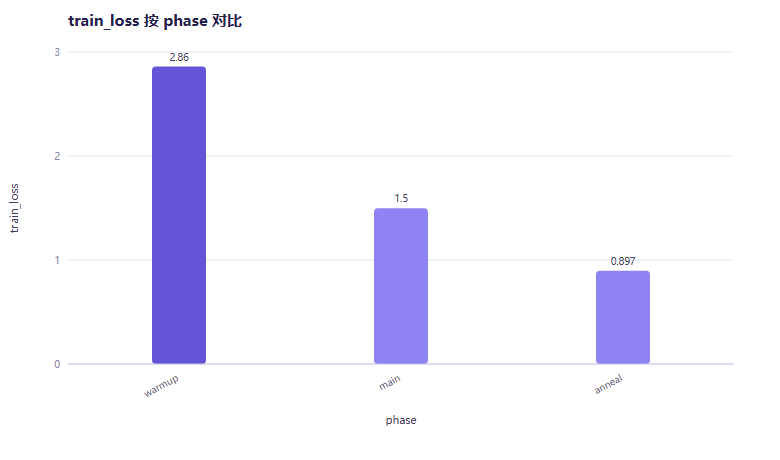
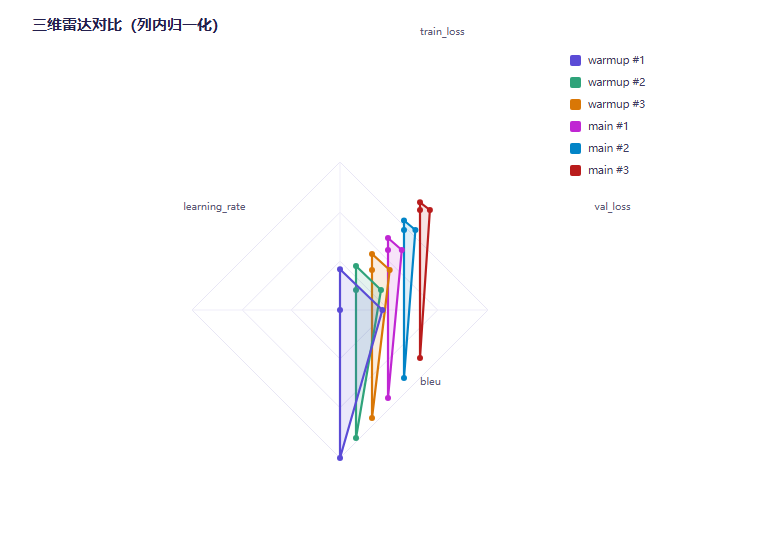

# 1. 项目详情与使用方式

## 1.1 项目定位

ResearchPilot 是一个**本地优先的科研阅读与写作助手**：把一篇（或一批）PDF 论文变成可检索、可核对、可对照阅读、可复用的结构化知识，并在此基础上提供抗幻觉问答、跨文献对比、中英对照翻译、写作框架与数据可视化五类能力。

设计原则只有一条：**能给出出处就说，给不出就明确说不知道**。所有结论都绑定到"哪篇论文、第几页、哪一节"的证据锚点上，而不是让模型自由发挥。

整体是一个 26 个 HTTP 接口的后端（FastAPI）+ 单页前端（React 19），数据全部落在本地 `data/` 目录；提供了单容器部署方式，可一键发布到公网。

## 1.2 使用方式

| 步骤 | 操作 | 说明 |
|---|---|---|
| 1 | 上传论文 | 支持单篇或批量（一次最多 20 篇），入库前先做版本与内容查重 |
| 2 | 提问 | 可单篇提问，也可勾选「多篇对比」；回答带证据编号，可展开核对原文 |
| 3 | 结构化阅读 | 「结构化解析」中查看标题树、表格、图表、公式、参考文献，正文 `[12]` 可双向跳转 |
| 4 | 中英对照 | 按章节渐进翻译，读一节译一节，回看直接命中缓存 |
| 5 | 写作与图表 | 生成论文框架（参考文献只来自库内论文）、上传 CSV 出图表与图注 |
| 6 | 取回原件 | 论文列表里点下载图标，取回入库时留档的原始 PDF |

## 1.3 运行环境

- 后端：Python 3.12 + FastAPI + ChromaDB + PyMuPDF + RapidOCR（扫描件 OCR，无需 tesseract）
- 前端：React 19 + Vite
- 模型：DeepSeek（在线）或 Ollama（本地 `qwen2.5:7b` + `nomic-embed-text`），**二选一即可**
- 无 GPU 也能完整运行；没有本地模型时自动降级为内置哈希嵌入，界面会标注当前后端

# 2. 项目亮点

| 亮点 | 具体做法 | 可验证证据 |
|---|---|---|
| 结构化锚点检索 | 表格、图表、公式、文献、元信息各自成为带位置锚点的检索单元，命中即给出"第几页、哪一节、哪张表" | 541 页书籍解析出 6643 个锚点单元；证据卡片带页码与章节 |
| 断言级抗幻觉核验 | 生成后再逐句回查证据：语义支持度 + 数字一致性，输出"已核验 / 弱支持 / 未支持 / 无引用"四态 | 语义核验 87.5% 通过；刻意伪造的数字被判"未支持" |
| 无 Ollama 也能跑 | 嵌入后端可插拔，探活失败自动降级为内置 384 维哈希嵌入，两套索引按后缀隔离互不污染 | 关闭端口实测：`backend=hash`，索引 1.9s、问答 3.3s |
| 版本语义去重 | 同一论文不同版本按正文比对，给出相似度、新增/删除句数与保留建议 | v1 vs v7：相似度 90.0%，297 句匹配，建议保留 v7 |
| 确定性图注 | 图注由统计量（趋势、最陡区间、极差、峰值）直接生成，绕开大模型 | 上传 CSV 得"3.42 → 0.82，-76.0%，最陡 1→2"，与数据一致 |
| 可复现的工程 | 19 个离线用例（不联网、不需 Ollama、不需真实 Key）+ CI 双流水线 + 版式自检脚本 | `pytest` 19 passed / 3.2s；GitHub Actions 连续通过 |
| 大文档鲁棒性 | 定长切块 + 重叠拼接、单文档页数上限 600、超限明确 413 | 541 页 21.3 MB：切块 1.2s、入库 73s、峰值内存 664 MB、显存 0 |

# 3. AI 技术落地使用情况

## 3.1 哪些环节真的用了模型

| 环节 | 模型参与 | 不参与的部分（规则/算法完成） |
|---|---|---|
| 结构化解析 | 不参与 | 标题树、表格、图裁切、公式近似、参考文献切分全部由 PyMuPDF + 规则完成 |
| 检索 | 嵌入模型（Ollama 或内置哈希） | 向量召回 + BM25 + RRF 融合 + 规则加权，排序逻辑不调用生成模型 |
| 问答 | 生成模型（DeepSeek / 本地 7B） | 证据挑选、引用白名单、断言核验在模型之外完成 |
| 翻译 | 生成模型 | 分章节切片、批量并发、磁盘缓存、术语与公式保留由工程侧保证 |
| 写作框架 | 生成模型 | 参考文献白名单 `[R1]..[Rn]` 与越界校验在模型之外完成 |
| 数据图表 | **不参与** | CSV 画像、SVG 绘制、图注全是确定性代码 |

这样划分的收益：**最容易出错的"事实"由程序保证，最擅长的"表达"交给模型**。图注、文献、位置都不会被编造。

## 3.2 用量与成本控制

- 一次问答：证据包约 1 KB（4 条证据、上限 1400 字/条），而不是整篇论文，prompt 成本与文档长度基本无关；
- 一篇 15 页论文全量翻译：首次 37 次模型调用，二次打开 0 次（段落哈希缓存命中）；
- 降级模式：没有本地模型时只把"生成"交给在线模型，"检索与核验"全在本地，成本最低。

## 3.3 AI 系统的测试实践

大模型应用最难的是"可验证"。本项目把 AI 链路做成可离线复跑的测试：

1. **关端口强制降级**：把 `OLLAMA_BASE_URL` 指向关闭端口，逼出哈希嵌入分支并断言行为；
2. **桩函数替换模型调用**：`generate_answer` / `resolve_model` 在测试里被替换，不花额度、不依赖网络；
3. **现场合成 PDF 语料**：PyMuPDF 生成带标题、表格、参考文献的测试论文，不依赖外部文件；
4. **对抗用例**：故意让模型给出错误数字，断言核验能判"未支持"；故意给越界引用编号 `[R9]`，断言被检出；
5. **环境约束用例**：requirements 文件必须纯 ASCII（中文 Windows 的 GBK locale 会让 pip 直接崩）。

结果：19 个用例 3.2 秒跑完，CI 在 Ubuntu 上同样通过——说明不是"只在我电脑上能跑"。

# 4. 关键技术

## 4.1 版式感知解析

标题树用"字号加权中位数 + 编号点分深度 + 位置单调约束"推断；表格经 `find_tables` 抽取后按列数、非空率过滤，题注按"上方优先、水平有交集、距离 ≤160pt"配对；图表按图像面积阈值过滤后 150 dpi 裁图；公式按数学字体识别并还原上下标，给出置信度；参考文献单独切分，修复了"章节吞掉文末内容"的常见缺陷（v1 的"7 Conclusion"从 368 段降到 6 段）。

## 4.2 混合检索与锚点加权

向量召回 40 条 + BM25 召回 40 条（词袋含中文二元组与中英术语映射），RRF 融合后按规则重排：实体覆盖度、数字命中、意图（表格/公式/文献）、章节标题重合度，最后按配额选取证据。所有通道在同一候选池打分，避免"先截断后加权"导致强信号丢失。

## 4.3 断言核验

切句后逐句取所引证据，计算语义支持度（余弦 ÷0.62 归一）与数字一致性（数字须出现在证据文本或其页码/章节锚点中），置信度 = 0.65×语义 + 0.35×数字，映射为四态结论；无嵌入后端时切换 `numeric_only` 模式，输出"未核验"而不是误判。

## 4.4 降级与集合隔离

嵌入后端探测带 60 秒 TTL，失败即降级；Ollama 与哈希嵌入分别写入 `research_papers` / `research_papers_hash`（单元同理），维度与语义空间不兼容的问题被集合隔离彻底解决，切换后端不需要重建另一侧索引。

## 4.5 单容器部署

`Dockerfile` 两阶段构建（Node 构建前端 → Python 装后端），容器里只有一个进程：`/` 出页面，`/api/*` 由中间件剥掉前缀后交给既有路由，与本地 vite 代理行为完全一致。`demo_seed.py` 会在空库时自动灌入一篇"系统生成的示例论文"，避免评审打开看到空库。

# 5. 项目相关图片

以下截图均来自本机真实运行（`uvicorn` 单进程同时托管前端与接口）。

界面其余部分（结构化解析、双语对照、写作辅助）见演示视频与在线演示。

# 6. 发表与获奖情况

- 本项目**未在任何期刊、会议或平台发表**，也未参加过其他赛事或获得奖项。
- 代码与文档为本队原创；引用的开源组件（PyMuPDF、ChromaDB、FastAPI、RapidOCR、React、Vite）均按其许可证使用，未修改其源码。
- 技术文档中出现的所有性能数字均为本机实测，测试文件为公开论文（arXiv 1706.03762 的 v1/v7）与《Understanding Deep Learning》（541 页），后者由本队自行获取并仅用于本地测试，未随仓库分发。

# 7. 是否基于其他项目优化

- 本项目**不是**在任何现有开源项目基础上改造，代码为独立编写；仓库 Git 历史从第一行依赖到最终文档按依赖顺序提交，可逐次回溯。
- 借鉴的是**公开方法论文献**，不是他人代码：RAG 的"检索后生成"、BM25 词袋召回、RRF 名次融合、断句与句向量相似度，均为公开技术；本项目在其上做的工程与算法改造包括：
  1. **锚点单元**：把表格/图表/公式/文献从正文里拆成独立检索单元并携带位置锚点（公开 RAG 方案通常只切段落）；
  2. **断言级核验**：在生成之后做逐句证据回查并输出四态结论（多数方案只做检索增强，不做生成后校验）；
  3. **双后端集合隔离 + 自动降级**：让"没有本地模型"也成为一个可运行、可测试的正式分支；
  4. **前端批次内查重**：上传前按 arXiv 编号做批次内比对，覆盖"库为空时同时上传 v1/v7"这一现实场景；
  5. **无模型参与的确定性图注**：用统计量生成图注，从机制上排除"图注与数据不符"。
- 若需进一步区分：数据可视化模块的 SVG 绘制代码为本队手写（环境无法安装 matplotlib）；文档排版工具 `docs/md_to_pdf.py` 亦为本队手写，用于在没有 LaTeX/Word 的环境下产出本技术文档与作品介绍文档。
